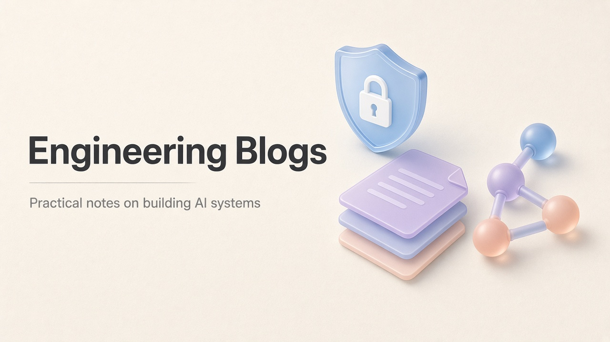

<p align="center">
  
</p>

# Engineering Blogs

Hi, I'm **Yuvraj Singh**, an AI engineer who builds LLM systems for production: agents, retrieval (RAG), document AI, and voice AI.

This repo is where I write up what I learn from that work. Not theory summaries, but the things that only show up when you actually build: what broke, what I tried, what the numbers said, and which trade-offs I'd make again.

## What you'll find here

Each post follows the same shape:

- **The problem**: why it matters in a real system
- **The concept**: explained plainly, without buzzwords
- **The experiment**: the setup, the attack or failure, the fix
- **The results**: measured, not guessed
- **The trade-offs**: what it costs in latency, complexity, or false positives

## Series

| Series | Status |
| --- | --- |
| [AI Security & Guardrails](posts/ai-security/) | In progress |
| [RAG in Production](posts/rag/) | Coming soon |
| [MCP & Agent Tooling](posts/mcp/) | Coming soon |

### AI Security & Guardrails

Prompt injection can't be fully solved, but it can be contained by design. This series walks through jailbreaks, input classifiers, spotlighting, the dual-LLM pattern, tool-level controls, data-leak prevention, MCP security, and red-teaming, each tested hands-on. See the [full list of posts](posts/ai-security/).

## Read and follow

Posts are published on Hashnode and shared on:

- X: [@yuvraajsinghh1](https://x.com/yuvraajsinghh1)
- LinkedIn: [Yuvraj Singh](https://www.linkedin.com/in/yuvraaj-singh/)
- Portfolio: [Portfolio site](https://master.d24o598po2jt0p.amplifyapp.com/)

Found a mistake or have a better approach? Open an issue. I'd genuinely like to hear it.

## Repo layout

```
posts/<topic>/NN-short-slug.md   posts
posts/<topic>/images/            images for each series
templates/post-template.md       post template
```
